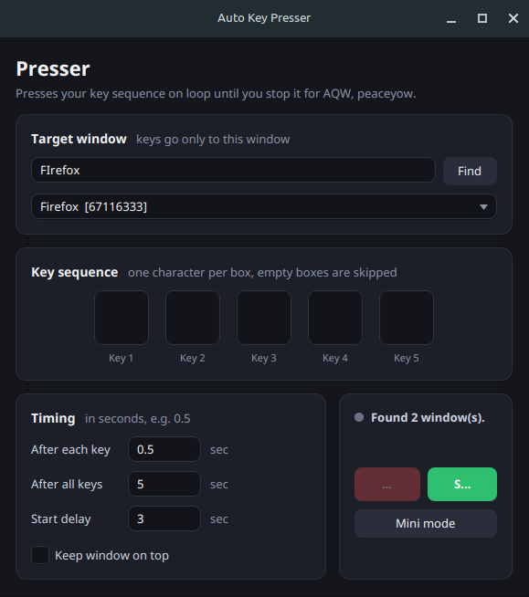

# AutoKeyPresser

A simple Java Swing utility to automate key pressing — originally created to support game development (**AQW**), but handy for any repetitive input tasks.



---

## Features

- 🖱 **Graphical Interface** — No need to deal with command-line automation tools.
- ⌨ **Custom Key Bindings** — Choose exactly which keys to press.
- ⏱ **Custom Delay Intervals** — Set precise time gaps between key presses.
- 🔁 **Repeat Function** — Automatically loop the sequence until stopped.
- 🎮 **Game-Friendly** — Originally built for AQW, but works with any application.
- ⚙ **Lightweight & Portable** — Just one `.exe` file, no installer required.

---

## Installation (Windows)

### Requirements

You need **Java 21** (or newer) installed on your machine.

Check if you already have it:

```bash
java -version
```

If it's not installed, download and install **Java 21 (JDK)** from [Eclipse Temurin](https://adoptium.net/temurin/releases/?version=21).

### Steps

1. Go to the [Releases](../../releases) page (or the repo root) and download **`AutoKeyPresser.exe`**.
2. Make sure Java 21+ is installed (see above).
3. Double-click **`AutoKeyPresser.exe`** to launch the app — no installation, no setup.

That's it. The app runs directly from the `.exe`.

> ⚠️ If Java isn't installed, Windows will show an error saying a Java Runtime Environment is required. Just install Java 21 from the link above and try again.

---

## Platform Compatibility

- **Windows** — Native `.exe`, tested on Windows 10/11.
- **Linux / macOS** — Run the app via the `.jar` file instead:
  ```bash
  java -jar AutoKeyPresser.jar
  ```

---

## Background

I originally built this for automating sequences in **AQW** game development, but it can be useful for **any scenario** where you need repeated keystrokes — testing, forms, automation tools, etc.

---

## License

Licensed under the **MIT License** — feel free to use, modify, and redistribute.

---

## Contributions

💡 Have ideas or features to suggest? Open an **issue** or **PR**!

1. Fork and clone the repository:
   ```bash
   git clone https://github.com/james-paul25/AutoKeyPresser.git
   cd AutoKeyPresser
   ```
2. Install Java JDK 21+.
3. Build and test locally (optional):
   ```bash
   mkdir -p out
   javac -d out src/*.java
   jar cfm AutoKeyPresser.jar manifest.txt -C out .
   ```
4. Make your changes, then commit and push:
   ```bash
   git add .
   git commit -m "Describe your changes"
   git push origin <your-branch-name>
   ```
5. Open a Pull Request on GitHub.